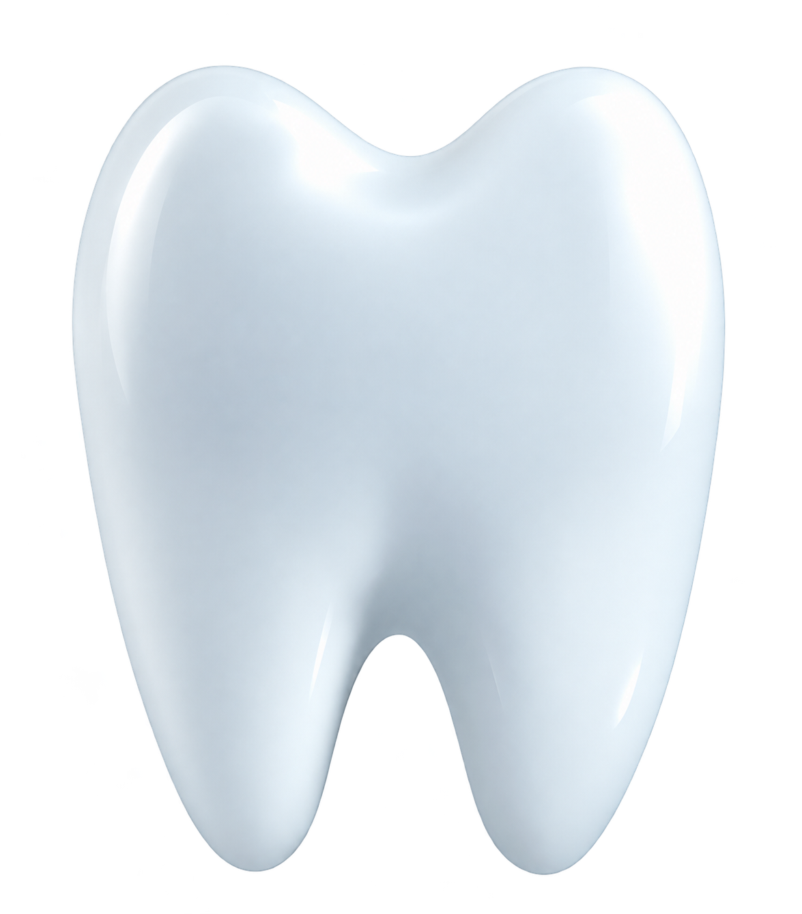
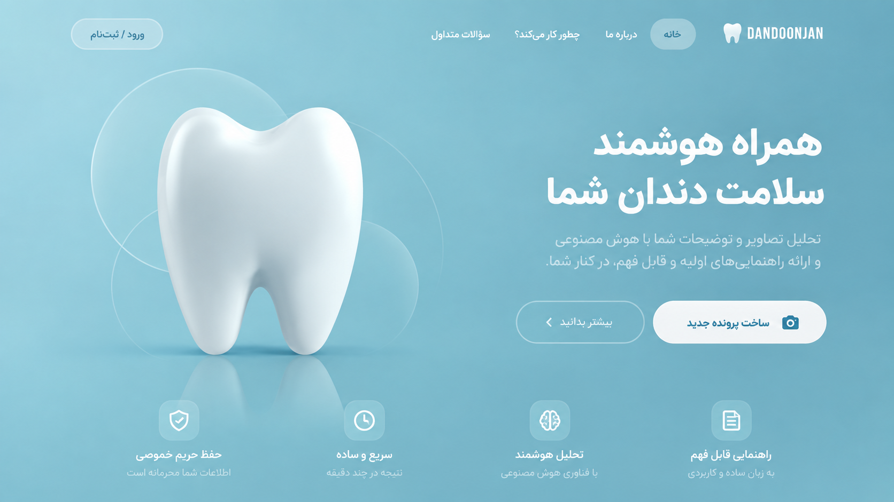

<div align="center">

<h1>
  
  دندون‌جان | DANDOONJAN
</h1>

<h3>Persian-first Dental Evidence Intelligence Platform</h3>

<p><strong>A Persian-first platform for turning dental evidence into structured, traceable reports.</strong></p>

<br>


<br><br>

<strong>Evidence → Assessment → Explanation</strong>

</div>

---



---

## About DANDOONJAN

**دندون‌جان** یک وب‌اپلیکیشن فارسی برای سازمان‌دهی و تحلیل شواهد مرتبط با پرونده‌های دندان‌پزشکی است.

کاربر می‌تواند سؤال، توضیحات پرونده و مدارک موجود را ثبت کند. سیستم اطلاعات را پردازش کرده و پیش از تولید گزارش، آن‌ها را به یک مدل ساختاریافته و قابل ردیابی از شواهد تبدیل می‌کند.

هدف اصلی پروژه ایجاد یک workflow قابل‌ردیابی از **Evidence** تا **Assessment** و در نهایت **Explanation** است؛ به‌گونه‌ای که منشأ یافته‌های مهم در طول پردازش حفظ شود.

> **DANDOONJAN is not a diagnostic chatbot and is not a replacement for a dentist.**

هدف سیستم کمک به سازمان‌دهی و فهم بهتر مدارک، مشخص‌کردن اطلاعات ناقص و آماده‌شدن برای گفت‌وگوی آگاهانه‌تر با متخصص دندان‌پزشکی است.

---

## 🌟 Project Highlights

| | Highlight | Description |
|---|---|---|
| 🔗 | **Evidence Provenance** | Findings remain traceable to their source evidence throughout the workflow. |
| 🧠 | **Structured Assessment** | Evidence is normalized and structured before explanations and reports are generated. |
| 🛡️ | **Safety-first Architecture** | Safety gates, fail-closed behavior and explicit evidence boundaries are built into the workflow. |
| 🤖 | **AI Gateway** | AI-provider logic is separated from the application workflow and supports deterministic offline Demo execution. |

---

## ✨ Key Features

- 🇮🇷 Persian-first responsive interface with full RTL support
- 🗂️ Structured dental case intake
- 📎 Evidence and document ingestion
- Structured treatment and tooth normalization
- 📄 Structured extraction from synthetic documents
- 🔗 Provenance tracking from findings back to source evidence
- 🔍 Evidence-gap detection
- 🧠 Structured assessment generation
- 👤 Patient-facing report view
- 👩‍⚕️ Professional report view
- 📸 Immutable assessment and report snapshots
- 🔐 Authentication and session isolation
- 🛡️ CSRF protection and case ownership boundaries
- ⚠️ Safety gates and fail-closed behavior
- 🤖 Deterministic offline Demo provider
- 📑 PDF and report workflow
- 🗄️ PostgreSQL support and database migrations
- 🧪 Automated unit, integration, security and regression testing

---

## 🛠️ Tech Stack

<div align="center">

### Backend

`Python 3.11` · `FastAPI` · `Pydantic` · `Uvicorn`

### Database

`PostgreSQL` · `SQLAlchemy` · `Alembic` · `psycopg`

### Frontend

`HTML5` · `CSS3` · `Vanilla JavaScript` · `RTL / Persian UI`

### Documents & Media

`PyMuPDF` · `Pillow` · `python-multipart`

### Security

`Argon2` · `CSRF Protection` · `Session Isolation` · `Ownership Boundaries`

### Testing & Engineering

`Pytest` · `HTTPX` · `Regression Testing` · `Versioned Prompts & Schemas`

### Infrastructure

`Docker` · `Environment-based Configuration`

</div>

---

## 🏗️ Architecture

The central design principle of DANDOONJAN is:

```text
Files
  │
  ▼
Ingestion & Validation
  │
  ▼
Structured Extraction
  │
  ▼
Normalized Evidence + Provenance
  │
  ▼
Assessment
  │
  ▼
Immutable Snapshot
  │
  ▼
Patient / Professional Explanation
```

Raw uploaded files do **not** directly become patient-facing answers.

Material findings retain provenance information such as their source artifact and relevant extraction context.

Different categories of information are kept conceptually separate throughout the workflow:

- **Patient-reported** information
- **Clinician-reported** information
- **Document-extracted** information
- **Model-inferred** information

This separation makes assessments more traceable and reduces the risk of presenting inferred information as source evidence.

---

## 🤖 AI & Safety Architecture

DANDOONJAN uses an AI gateway abstraction to separate application logic from the underlying AI provider.

For the Portfolio Demo, the project can use a deterministic offline provider:

```env
DJ_AI_PROVIDER=mock
```

This allows the workflow to run without requiring paid AI credentials.

The architecture also supports configuration for a real provider when explicitly enabled.

### 🛡️ Safety mechanisms

- 🔗 Evidence provenance
- 🔍 Evidence-gap detection
- ⚠️ Safety gates
- Fail-closed behavior
- 📸 Immutable assessment snapshots
- Separation of reported, extracted and inferred information
- 🔐 Authentication and authorization boundaries
- Case ownership enforcement
- Synthetic Portfolio Demo data
- Explicit limitations around medical interpretation

### ⚕️ Medical limitation

DANDOONJAN is a **software engineering and Portfolio project**, not a clinically validated medical device.

The Portfolio Demo does not perform genuine radiographic interpretation. Generated information must not be interpreted as a medical diagnosis, prescription or proof that a particular treatment is required.

Treatment decisions must be made with a qualified dental professional.

---

## 🎮 Portfolio Demo

The version published in this repository is intended for technical demonstration and Portfolio use.

All Demo data is **synthetic**.

The application includes a sample-case workflow that allows the system to be explored without entering real patient information.

When using the offline Demo configuration, no OpenAI, OpenRouter or other paid API key is required.

---

## 🚀 Run Locally

### 1. Clone the repository

```bash
git clone https://github.com/Fadesasadeghi/dandoonjan.git
cd dandoonjan
```

### 2. Create a virtual environment

**Linux / macOS**

```bash
python -m venv .venv
source .venv/bin/activate
```

**Windows**

```powershell
python -m venv .venv
.venv\Scripts\activate
```

### 3. Install dependencies

```bash
pip install -r requirements.txt
```

### 4. Create the environment configuration

**Linux / macOS**

```bash
cp .env.example .env
```

**Windows PowerShell**

```powershell
Copy-Item .env.example .env
```

### 5. Start the application

```bash
python -m uvicorn app.main:app --host 127.0.0.1 --port 8000 --log-config app/logging.json
```

Then open:

```text
http://127.0.0.1:8000
```

No paid AI credentials are required for the offline Demo configuration.

---

## 🧪 Tests

Run the automated test suite:

```bash
python -m pytest tests -q
```

The repository includes automated tests covering:

`Core Workflow` · `Evidence Ingestion` · `Authentication` · `Authorization` · `Provenance` · `Immutable Snapshots` · `Safety Behavior` · `Integration` · `Regression`

---

## 🗄️ Database Migrations

Apply database migrations with:

```bash
alembic upgrade head
```

---

## 📚 Engineering Documentation

DANDOONJAN retains a significant portion of its engineering documentation and development history.

This is intentional: the repository demonstrates not only the resulting application, but also parts of the engineering process used to build, test and refine it.

Additional technical material is available under:

```text
docs/
evaluation/
verification/
```

These materials include architectural decisions, testing records, safety considerations, UI development evidence and development gates.

---

## ⚠️ Limitations

- All Portfolio Demo data is synthetic.
- Do not enter real patient or sensitive medical information into a public deployment.
- Demo mode does not perform genuine radiographic interpretation.
- Generated explanations are not medical diagnoses.
- Generated output must not be used as proof of treatment necessity.
- Treatment decisions must be made with a qualified dental professional.
- The development Knowledge Pack included in the repository is not clinically validated.
- Some workflows and deployment-related functionality remain under development.

---

## 👩‍💻 Project Credits

### Software Developer

**Fatemeh Sadeghi**

Design and implementation of the software and its codebase, including application development, architecture implementation, frontend and backend development, testing and technical refinement.

### Project Manager

**Mehdi Abbasy**

Project management and coordination.

This project was originally developed as a commissioned software project and is published here for **Portfolio and technical demonstration purposes with permission**.

---

## 🚧 Project Status

> **Work in Progress**

DANDOONJAN is under active development.

This repository represents the current development state of the project. Some workflows and deployment-related features are still being completed and refined.

---

<div align="center">

### DANDOONJAN

**Structured evidence. Traceable assessment. Clearer explanation.**

</div>
